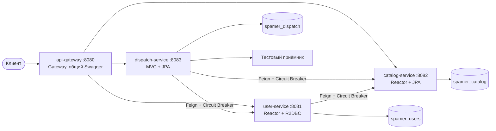
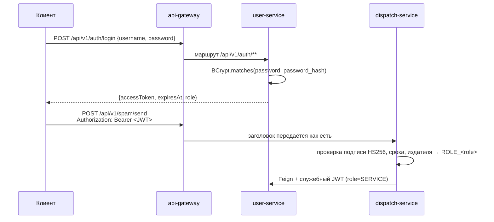

# Spamer Microservices — Лабораторные работы №2 и №3

Монолит из лабораторной №1 разделён на микросервисы на Spring Cloud. Это
**учебный проект**: CRUD, биллинг и реальная HTTP-отправка на **свой тестовый
приёмник**. Адрес приёмника берётся только из конфигурации оператора
(`SENDER_TARGET_URL`): тело запроса не может выбрать, куда пойдёт соединение.
Прокси остаются связью в БД, трафик через них не маршрутизируется.

## Архитектура



Все сервисы получают конфигурацию из `config-server` (:8888) и регистрируются в
`eureka-server` (:8761). Снаружи опубликованы только gateway, панель Eureka и
порт PostgreSQL.

| Модуль | Отвечает за | Стек |
|--------|-------------|------|
| `config-server` | раздаёт конфигурацию из отдельного git-репозитория `config-repo/` | Config Server, Git |
| `eureka-server` | реестр сервисов | Eureka Server |
| `api-gateway` | единая точка входа, общий Swagger, fallback | Spring Cloud Gateway |
| `user-service` | `users`, `user_service_subscriptions`, `balance_operations` | WebFlux, **Reactor + R2DBC** |
| `catalog-service` | `services` | WebFlux, **Reactor + Spring Data JPA** |
| `dispatch-service` | `proxy`, `spam_log`, `spam_log_proxy`, отправка | Spring MVC, JPA, Feign |
| `common` | формат ошибок, обработка ошибок Feign, настройки Circuit Breaker | библиотека |

### Выполнение требований

| Требование | Где реализовано |
|-----------|-----------------|
| Регистрация в Eureka | `eureka-server`, клиент во всех сервисах |
| Конфигурация из Config Server | отдельный репозиторий `config-repo/`, Git-бэкенд config-server, `spring.config.import` в клиентах |
| Доступ через Spring Gateway | маршруты в `config-repo/api-gateway/api-gateway.yml` |
| Feign Client | `dispatch-service/.../client`, `user-service/.../client` |
| Circuit Breaker | Resilience4j: Feign-клиенты (`FeignCircuitBreakerConfig`) и маршруты gateway |
| Reactor + R2DBC | `user-service` |
| Reactor + Spring Data JPA | `catalog-service`: JPA выполняется на `boundedElastic` (`ServiceCatalogService`) |

Вместо Hystrix из ссылки в задании используется Resilience4j: Hystrix удалён из
Spring Cloud, а это его штатная замена через Spring Cloud Circuit Breaker.

## Лабораторная №3: авторизация и роли

| Требование | Где реализовано |
|-----------|-----------------|
| Spring Security + JWT в заголовке `Authorization` | каждый доменный сервис — stateless resource server (`*/security/SecurityConfig`); токен выдаёт `POST /api/v1/auth/login` |
| Ролевая модель | роли `SUPERVISOR`, `BUY_OPERATOR`, `USER_PRO`, `USER_FREE`, `VICTIM` (`common/.../security/Roles`), правила — `@PreAuthorize` на контроллерах |
| Логика зависит от текущего пользователя | `DispatchAccessPolicy`, `SubscriptionService.authorize`, `UserService.get/patch` — см. таблицу ниже |
| Пароль не отдаётся | в `UserResponse` нет пароля; во входных DTO поле `password` помечено `WRITE_ONLY` и скрыто в `toString()` |
| Пароли хранятся хэшами | BCrypt (`PasswordHasher`), колонка `users.password_hash`, миграция `004-add-auth.yaml` |
| Пользователей создают только супервайзеры | `POST /api/v1/users` — `hasRole('SUPERVISOR')`; первый супервайзер создаётся при старте (`SupervisorBootstrap`) |

### Как это устроено



- Токен — JWT HS256 с общим секретом `JWT_SECRET` (не короче 32 байт, иначе сервис не стартует).
  В токене: `sub` = id пользователя, `username`, `role`, `iss`, `iat`, `exp`. Пароля и хэша в нём нет.
- Gateway токен не разбирает, а пропускает дальше; проверяет его **каждый** сервис сам. Так
  внутренний сервис не доверяет запросу только потому, что тот пришёл из внутренней сети.
- Вызовы между сервисами (Feign) подписываются служебным токеном с ролью `SERVICE`
  (`ServiceTokenInterceptor`). Он нужен и там, где пользователя нет вовсе — например, при
  повторе возвратов по расписанию. Эндпоинты `/internal/**` принимают только этот токен.
- Сессий нет (`STATELESS`, `NoOpServerSecurityContextRepository`), CSRF выключен: cookie не
  используются. Ошибки 401/403 приходят в общем формате `ApiError`.
- Swagger и `/actuator/health` открыты; в Swagger есть кнопка **Authorize** (схема `bearerAuth`).

### Роли

| Действие | SUPERVISOR | BUY_OPERATOR | USER_PRO | USER_FREE | VICTIM |
|----------|:---:|:---:|:---:|:---:|:---:|
| Создать / заменить / удалить пользователя, список | ✓ | — | — | — | — |
| Посмотреть профиль | любой | свой | свой | свой | свой |
| `PATCH /users/{id}` | любые поля любого | свой: email, пароль | свой: email, пароль | свой: email, пароль | свой: email, пароль |
| Подписка `POST /subscriptions` | любого, со скидкой | — | себя, без скидки | себя, без скидки | — |
| Каталог сервисов: чтение | ✓ | ✓ | ✓ | ✓ | ✓ |
| Каталог сервисов: изменение | ✓ | ✓ | — | — | — |
| Прокси: чтение и изменение | ✓ | ✓ | — | — | — |
| `POST /spam/send` | от имени любого (`userId` обязателен) | — | от себя, до 100 сообщ. | от себя, до 10 сообщ. | — |
| Журнал `spam-log`: чтение | весь | — | только свои записи | только свои записи | — |
| Журнал `spam-log`: ручное изменение | ✓ | — | — | — | — |

Аналог примера из задания: **оператор закупок не может делать рассылки, а клиент не может
закупать прокси и менять каталог** (как повар не загружает склад, а логист не принимает заказы).

Методы, логика которых меняется в зависимости от пользователя (а не только «пустить/не пустить»):

| Метод | Что меняется |
|-------|--------------|
| `POST /spam/send` | у клиента `userId` берётся из токена (чужой — 403), у `USER_FREE` лимит 10 сообщений (`spamer.limits.free-max-messages`); супервайзер отправляет от имени указанного пользователя |
| `GET /spam-log`, `/spam-log/feed` | супервайзер видит весь журнал, клиент — только свои записи (и `X-Total-Count` считается по ним) |
| `POST /subscriptions` | клиент подписывает только себя и без скидки, супервайзер — кого угодно со скидкой |
| `PATCH /users/{id}` | супервайзер меняет любые поля, владелец — только email и пароль |
| `GET /users/{id}` | супервайзер и сервисы видят всех, остальные — только себя |

Роль берётся из токена. Если она изменилась (например, после подписки `USER_FREE` стал
`USER_PRO`), новая роль начнёт действовать после повторного входа. Токен живёт `JWT_TTL`
(по умолчанию 1 час); отзыв токенов до истечения не реализован.

### Первый вход

Пользователей создают только супервайзеры, поэтому первый супервайзер создаётся при старте
user-service из `SUPERVISOR_USERNAME` / `SUPERVISOR_PASSWORD` — только если в базе нет ни одного
супервайзера. В `docker-compose.yml` по умолчанию `supervisor` / `supervisor-pass`; для защиты
их стоит переопределить.

```bash
TOKEN=$(curl -s -X POST localhost:8080/api/v1/auth/login -H 'Content-Type: application/json' \
  -d '{"username":"supervisor","password":"supervisor-pass"}' | python3 -c "import sys,json; print(json.load(sys.stdin)['accessToken'])")

curl -X POST localhost:8080/api/v1/users -H "Authorization: Bearer $TOKEN" -H 'Content-Type: application/json' \
  -d '{"username":"alice","email":"alice@example.com","role":"USER_PRO","balance":"100.00","password":"alice-password"}'
```

Новые эндпоинты: `POST /api/v1/auth/login` (открыт) и `GET /api/v1/users/me`. Маршрут
`/api/v1/auth/**` задан в коде gateway (`AuthRouteConfig`), поэтому `config-repo` менять не нужно.

**Миграция данных из лабораторной №2.** Роль `ADMIN` переименована в `SUPERVISOR`. Старые
пользователи получают заглушку вместо хэша и войти не могут, пока супервайзер не задаст им
пароль через `PATCH /users/{id}` `{"password": "..."}`.

## Запуск

```bash
docker compose up --build
```

Первый запуск занимает несколько минут. Система готова, когда `docker compose ps`
показывает `healthy` у всех сервисов. Нужно примерно 3 ГБ свободной памяти.

- API и общий Swagger: http://localhost:8080/swagger-ui.html (сервис выбирается в списке вверху)
- Панель Eureka: http://localhost:8761

Основные переменные окружения:

| Переменная | Назначение |
|------------|------------|
| `DB_USERNAME`, `DB_PASSWORD` | учётные данные PostgreSQL |
| `SENDER_TARGET_URL` | адрес приёмника для `/spam/send` |
| `JWT_SECRET` | общий секрет подписи JWT (≥ 32 байт), одинаковый во всех сервисах |
| `JWT_TTL` | срок жизни токена, по умолчанию `1h` |
| `SUPERVISOR_USERNAME`, `SUPERVISOR_PASSWORD` | первый супервайзер (создаётся, если супервайзеров нет) |
| `REFUND_RETRY_DELAY_MS` | интервал повтора незавершённых возвратов |

## Тесты

```bash
mvn verify                # нужен запущенный Docker (Testcontainers)
```

Порог покрытия JaCoCo — 70% по строкам в каждом доменном сервисе
(`user-service`, `catalog-service`, `dispatch-service`). Общий отчёт по всем
модулям: `target/site/jacoco/index.html`. Отчёт
отдельного модуля: `<модуль>/target/site/jacoco/index.html`.

- Модульные тесты: сага `SpamSendService`, возвраты, `SubscriptionService`, разбор ошибок Feign.
- Интеграционные тесты на реальном PostgreSQL: API всех сервисов.
- Безопасность: `SecurityApiTest` (логин, BCrypt-хэш в базе, пароль не в ответах, 401/403,
  супервайзер при старте, служебный токен), проверки ролей в `DispatchApiTest` и
  `ServiceCatalogApiTest`, модульные `JwtSupportTest`, `DispatchAccessPolicyTest`.
- `CatalogClientCircuitBreakerTest`: настоящая цепочка Feign → балансировщик → HTTP
  → Circuit Breaker. Проверяет, что 404 не размыкает breaker, а после серии сбоев
  вызовы к сервису прекращаются.

## REST API

Все запросы идут через gateway на порт 8080 с префиксом `/api/v1`. С лабораторной №3 все
запросы, кроме логина, требуют заголовок `Authorization: Bearer <JWT>`.

| Путь | Сервис |
|------|--------|
| `/auth/login`, `/users/**`, `/subscriptions` | user-service |
| `/services/**` | catalog-service |
| `/proxy/**`, `/spam-log/**`, `/spam/send`, `/test-receiver/inbox` | dispatch-service |

Изменился один случай: если нужный сервис недоступен, ответом будет `503` с
читаемым сообщением. Новые эндпоинты списания и возврата находятся в
`/internal/**`, gateway их не маршрутизирует.

Пагинация: `GET /users?page=&size=` отдаёт `X-Total-Count`,
`GET /spam-log/feed?cursor=&size=` работает как бесконечная прокрутка без общего
количества. `size` не больше 50.

## Что изменила декомпозиция

### Данные

У каждого сервиса своя база, поэтому внешние ключи между сервисами стали
логическими ссылками, которые проверяются через Feign при записи.

| Связь | Тип | Где теперь |
|-------|-----|-----------|
| `spam_log` ↔ `proxy` | Many-to-Many | внутри `dispatch-service`, настоящая связь JPA |
| `users` → подписки | One-to-Many | внутри `user-service`, настоящий внешний ключ |
| `users` ↔ `services` | Many-to-Many с доп. полями | `service_id` — логическая ссылка на `catalog-service` |
| `users` → `spam_log` | One-to-Many | `user_id` — логическая ссылка на `user-service` |
| `services` → `proxy` | One-to-Many | `provider_id` — логическая ссылка на `catalog-service` |

**Известное ограничение.** Каскадное удаление между сервисами больше не работает.
После удаления пользователя его записи `spam_log` остаются как журнал, а после
удаления сервиса остаются подписки и `provider_id` на него. Рассылка событий об
удалении естественно ложится на Kafka/RabbitMQ из лабораторной №4.

### Транзакции

**`POST /subscriptions` — локальная транзакция.** Подписка и роль пользователя
лежат в одной базе, поэтому остались атомарными: иначе возможны состояния «PRO без
подписки» или «подписка есть, а роль не сменилась». Запрос в каталог выполняется
до транзакции, чтобы медленный сервис не удерживал соединение с БД.

**`POST /spam/send` — сага.** Баланс и журнал теперь в разных базах, общая
транзакция невозможна:

1. Получить цену из `catalog-service`.
2. Создать в журнале запись `QUEUED`.
3. Списать деньги в `user-service`. Эта операция сама выполняется в транзакции
   (запись операции + изменение баланса).
4. Отправить сообщения на приёмник.
5. Успех: `SENT`. Ошибка доставки: `FAILED` и возврат денег.

Сбои обрабатываются так:

| Сбой | Что происходит |
|------|----------------|
| Мало денег или нет пользователя | запись журнала удаляется, `422` или `404` |
| Приёмник отказал | `FAILED`, деньги возвращаются, `422` |
| `user-service` недоступен при списании | неизвестно, прошло ли списание, поэтому отправляется возврат, `503` |
| `user-service` недоступен при возврате | флаг `refund_pending`, повтор по расписанию |

Повторы безопасны, потому что списание и возврат идемпотентны по `operationId`
(таблица `balance_operations`). Повторная операция ничего не меняет, а возврат
неизвестной операции оставляет запись с нулевой суммой, из-за которой опоздавшее
списание будет отклонено.

Как и в лабораторной №1, принятый приёмником запрос отменить нельзя: если сообщение
2 из N не дошло, деньги вернутся, но первое сообщение приёмник уже получил.

## Демо для защиты

```bash
./demo/demo.sh                # вход, создание пользователей супервайзером, отправка от имени клиента
./demo/roles.sh               # одно и то же действие под разными ролями: 200/201 или 403
./demo/circuit-breaker.sh     # остановка сервиса, 503 и восстановление
```

Приёмник на своём сервере:

```bash
PORT=9000 python3 demo/receiver.py                       # на сервере
SENDER_TARGET_URL=http://<IP>:9000/inbox docker compose up --build
```

## Структура

```
├── common/             # ошибки, Feign и Circuit Breaker, JWT (security/)
├── config-repo/        # отдельный git-репозиторий: папка на сервис и общий application.yml
├── config-server/      # читает config-repo по Git (file:// или CONFIG_REPO_URI)
├── eureka-server/
├── api-gateway/
├── user-service/       # controller, service, domain, dto, client
├── catalog-service/    # controller, service, domain, dto, mapper
├── dispatch-service/   # controller, service, domain, dto, mapper, client
├── docker/postgres/    # создание баз при первом запуске
└── demo/
```
